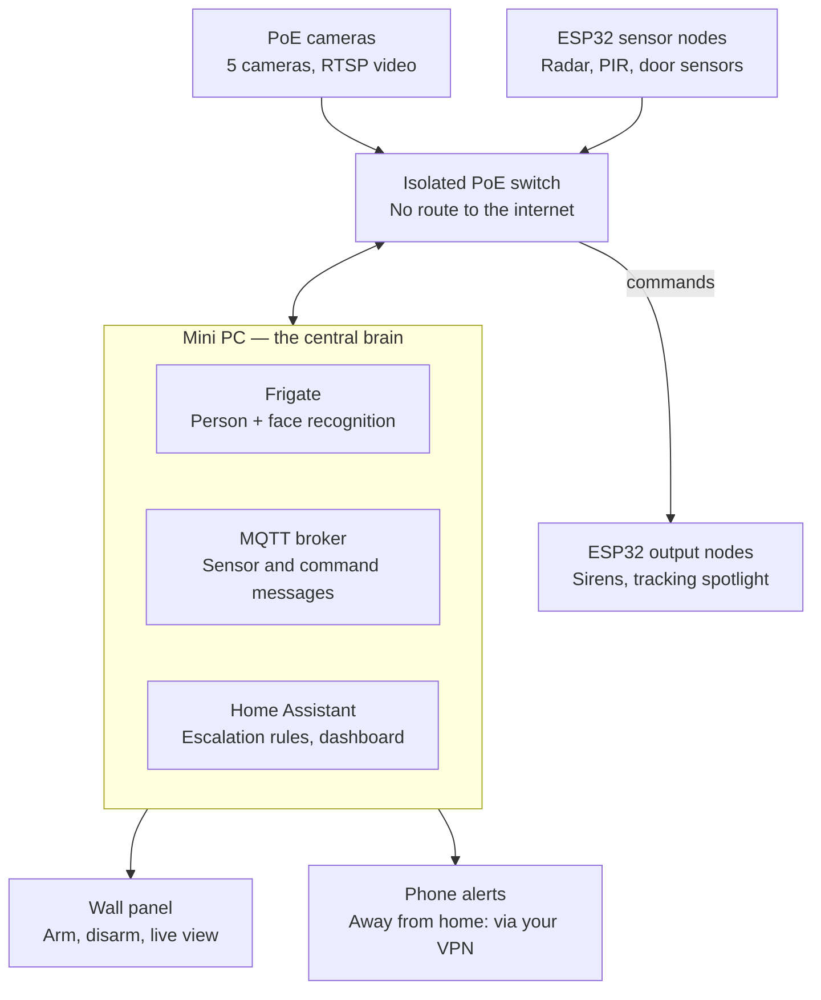

# Ironclad — Offline AI Home Security System

Project plan · Oct 6, 2026

## Overview

Ironclad is a fully offline home security system: a mini PC runs local AI that watches 5 cameras and a sensor network around the clock, confirms intruders, and responds with a tracking spotlight, sirens, voice warnings and alerts. Nothing depends on the internet or a cloud account.

Design principles:

- **Fully offline.** All processing runs on the mini PC. Cameras and sensors sit on an isolated network with no route to the internet.
- **Cost-efficient.** Reuse the mini PC, put 4MP cameras only where faces matter, and use cheap ESP32 nodes for sensors and outputs.
- **Confirm before acting.** Loud responses need two independent signals (camera + radar or door sensor), which keeps false alarms low.
- **Non-harmful deterrence only.** Light, sound, voice and lockdown. No device that can injure a person, since misidentification is always possible.
- **Human stays in control.** You can arm, disarm or cancel any response at any moment from a wall panel or your phone.

## System architecture

All cameras and ESP32 nodes connect through one isolated PoE switch to the mini PC, which runs three local services and is the only device that can reach them.

Cameras and sensor nodes report up to the mini PC; Home Assistant sends commands back down to the siren and spotlight nodes, and you control everything from the wall panel or your phone.

An intruder event flows like this:

1. A radar node detects presence and publishes an MQTT message.
2. Frigate confirms a person on the nearest camera and checks the face against enrolled household members.
3. Home Assistant combines both signals, decides the threat level and current mode, and commands the output nodes.
4. The spotlight tracks the person, the siren sounds if the level warrants it, you get an alert with a snapshot, and Frigate saves the clip.

## Hardware and cost plan

The full core build comes to about **49,000 BDT**, using the mini PC you already own. Prices are from Bangladeshi shops as of October 2026; rows marked *approx.* are estimates to confirm before buying.

| Item | Role | Qty | Unit (BDT) | Total (BDT) |
| --- | --- | --- | --- | --- |
| [TP-Link VIGI C340I 4MP bullet](https://www.startech.com.bd/tp-link-vigi-c340i-4mp-4mm-bullet-ip-camera) | Face recognition at entrance and gate | 2 | 3,949 | 7,898 |
| [TP-Link VIGI C220I 2MP dome](https://www.techlandbd.com/security-surveillance/ip-camera/tp-link-ip-camera) | General areas | 3 | 2,200 | 6,600 |
| [C-Data CS2082G-POE 8-port PoE switch](https://www.startech.com.bd/c-data-cs2082g-poe-8-port-gigabit-ethernet-switch) | Isolated camera network, 120W PoE | 1 | 5,700 | 5,700 |
| [HLK-LD2410C mmWave radar](https://store.roboticsbd.com/sensors/2351-hlk-ld2410c-24ghz-mmwave-5m-human-presence-radar-sensor-motion-module-robotics-bangladesh.html) | Indoor presence, works in darkness | 3 | 740 | 2,220 |
| [HC-SR501 PIR sensor](https://store.roboticsbd.com/sensors/2152-human-presence-radar-ld2410-respiration-and-heartbeat-monitoring-non-contact-induction-sensor-robotics-bangladesh.html) | Outdoor motion backup | 2 | 110 | 220 |
| [ESP32-S3 dev board](https://store.roboticsbd.com/development-boards/2367-esp32-s3-wroom-1-dual-type-c-usb-n16r8-micropython-board-robotics-bangladesh.html) | Sensor, siren and spotlight nodes | 4 | 945 | 3,780 |
| [12V strobe siren, 115dB](https://www.bdstall.com/details/strobe-light-12v-led-flashing-alarm-siren-home-security-20849/) | Indoor and outdoor alarm | 2 | 950 | 1,900 |
| [Metal pan-tilt bracket (MG996R)](https://store.roboticsbd.com/robotics-parts/3790-2-dof-short-pan-and-tilt-servo-bracket-mount-kit-robotics-bangladesh.html) | Tracking spotlight mount | 1 | 490 | 490 |
| MG996R servo, 180° positional | Pan and tilt motion (*approx.*) | 2 | 700 | 1,400 |
| 12V LED spotlight, 20-30W narrow beam | Tracking light (*approx.*) | 1 | 1,500 | 1,500 |
| Relays, MOSFETs, 12V PSU, enclosures | Power and switching (*approx.*) | 1 lot | 2,000 | 2,000 |
| Cat6 cable and connectors | Camera runs (*approx.*, depends on distances) | 1 lot | 3,000 | 3,000 |
| UPS for mini PC, switch and router | Keeps running through power cuts (*approx.*) | 1 | 5,000 | 5,000 |
| 2TB surveillance hard drive | 7 days continuous + 30 days of events (*approx.*) | 1 | 7,000 | 7,000 |
| **Total** | | | | **48,708** |

To cut cost to about 36,000 BDT, start without the UPS and hard drive if you already have spares, and add the second siren later. To upgrade, swap the ESP32-S3 boards on the PoE network for Ethernet ESP32 boards so no node uses Wi-Fi.

## Active deterrence: tracking light and siren

Ironclad deters with two outputs only: a white spotlight that follows the intruder and loud strobe sirens. Both make an intruder feel seen and exposed without causing injury.

### Tracking spotlight

1. Frigate detects a person and publishes the bounding box (where the person sits in the camera frame) over MQTT.
2. A small script on the mini PC converts the box centre into pan and tilt angles, using a one-time calibration that matches camera pixels to servo angles.
3. The spotlight ESP32 node receives the angles and drives two MG996R servos on the metal pan-tilt bracket, updating several times a second.
4. The node switches the 12V LED spotlight on through a MOSFET, steady or strobing.

Build notes:

- Mount the spotlight right next to the camera that steers it, so their views line up and calibration stays simple.
- Smooth the movement (move only when the target shifts noticeably) to stop servo jitter and wear.
- Cheaper fallback: 2-4 fixed floodlights, each covering a zone, switched on by the zone where a person is detected. No moving parts.

### Siren

- A 12V strobe siren indoors and one outdoors, each switched by a relay on an ESP32 node.
- Auto-off after 3 minutes, then re-arm. This avoids disturbing neighbours endlessly and keeps the siren from being ignored.
- A cancel action from the wall panel or phone silences everything instantly.

### Safety rules

- White LED light only. No lasers or other light sources that can damage eyes.
- Aim the spotlight's travel limits so it never points onto the street, neighbours' windows or traffic.
- Every output has a hard timeout and a manual off switch.

## Detection and escalation logic

Ironclad escalates in four levels, and the loud responses fire only after two independent signals agree. Home Assistant runs this logic using events from Frigate and the ESP32 sensors.

| Level | Trigger | Response |
| --- | --- | --- |
| 0 Watch | Any single sensor event, or a known face | Log the event and snapshot; nothing else |
| 1 Suspicious | Person detected by camera OR radar, face unknown or not visible | Floodlight on, quiet phone alert with snapshot |
| 2 Confirmed intruder | Camera person + radar/PIR/door sensor agree, face unknown | Tracking spotlight, voice warning, phone alert to all contacts, clip saved |
| 3 Alarm | Confirmed intruder stays 20+ seconds, forces a door, or tampers with a camera | Sirens + strobe, keep tracking, repeat alerts until acknowledged |

Alarm modes decide which levels can fire:

| Mode | When | Max level |
| --- | --- | --- |
| Home | Family awake and inside | 1 (outer areas only) |
| Night | Family asleep | 3 on outer doors and gate, 1 inside |
| Away | House empty | 3 everywhere |

False-alarm controls:

- **Known faces never escalate.** Enroll every household member with 5-10 photos; a recognized face drops the event to Level 0.
- **Camera tampering rule.** Radar sees a person but the camera sees nothing, or a camera goes dark → treat as Level 3.
- **Pet and plant filters.** Frigate's person detection ignores animals; outdoor PIR zones avoid trees and the street.
- **Grace period.** Disarming within 30 seconds of entering cancels the escalation, like a normal alarm keypad.

## Fully offline operation

Every function of Ironclad keeps working with the internet cable unplugged; only alerts to your phone while you are outside the house need a connection, and those go through your own VPN.

- **AI runs locally.** Frigate does person detection and face recognition on the mini PC, using its integrated graphics (OpenVINO) on an Intel CPU.
- **Voice warnings are local.** An offline text-to-speech engine such as Piper generates the warnings; play them through a speaker on the mini PC's audio output or an amplifier on an ESP32 node.
- **Isolated network.** The PoE switch connects only to a second Ethernet port on the mini PC. Cameras and nodes have no route to the internet.
- **Local alerts at home.** A wall tablet or old phone shows the Home Assistant dashboard and acts as the arm/disarm panel; the Home Assistant app on your phone works over home Wi-Fi.
- **Remote access only via VPN.** Use Tailscale or WireGuard to reach the mini PC from outside. Never open ports on the router.
- **Power backup.** The UPS keeps the mini PC, PoE switch and router running through load-shedding. Size it for at least 30-60 minutes.
- **Fail-safes.** Each ESP32 node runs a local fallback: if it loses contact with the mini PC for 60 seconds while armed, a door or radar trigger sounds its own siren. A watchdog restarts Frigate if it stops, and Home Assistant alerts you if any camera goes offline.

## Build phases

Build Ironclad in six phases, each usable on its own, so spending is spread out and every phase is tested before the next.

1. **Core recording.** Install Docker, Frigate and Home Assistant on the mini PC; connect the PoE switch on the second Ethernet port and the first 4MP entrance camera.
   - Done when: live view and 24/7 recording work with the internet unplugged.
2. **All cameras + person detection.** Add the remaining cameras, set detection zones, and run detection on substreams.
   - Done when: walking past each camera creates a person event within a second or two.
3. **Face recognition.** Enroll household members and tune the entrance and gate cameras (height, angle, lighting).
   - Done when: family members are recognized at the entrance in daylight and under the night light.
4. **Sensor layer.** Build the ESP32 nodes with radar, PIR and door sensors, reporting over MQTT.
   - Done when: every sensor event shows on the dashboard and matches camera events.
5. **Deterrence outputs.** Build the siren nodes, then the tracking spotlight; calibrate the pan-tilt aim.
   - Done when: the spotlight follows a person across the gate camera's view and the siren respects its timeout.
6. **Escalation logic + hardening.** Write the Level 0-3 automations and alarm modes, add the UPS, fail-safes and VPN.
   - Done when: a full test run in each mode (Home, Night, Away) behaves as the escalation table says, including a power cut.

## Risks, safety and next steps

The biggest risks are misidentification and false alarms, which is why Ironclad uses two-signal confirmation and only non-harmful outputs.

| Risk | Mitigation |
| --- | --- |
| Family member, guest or worker flagged as unknown | Enroll faces, use Home mode, keep outputs non-harmful, cancel from panel or phone |
| False alarms from pets, fans, rain or plants | Two-signal confirmation, Frigate person filter, tuned radar zones |
| Power cuts or load-shedding | UPS, ESP32 local fallback sirens |
| Camera covered or cut | Tampering rule triggers Level 3; camera-offline alert |
| Neighbour complaints or privacy concerns | Aim cameras at your own property, siren timeout, spotlight travel limits |
| Mini PC failure | Watchdog restarts; keep a config backup on a USB drive |

Keep emergency numbers ready: Ironclad alerts you, but calling 999 (Bangladesh national emergency) or your building's guard is still a human step.

Next steps:

- [ ] Map the 5 camera spots, the gate and every outer door on a floor plan
- [ ] Confirm the mini PC's CPU, RAM and spare Ethernet port (or buy a USB Ethernet adapter)
- [ ] Buy the Phase 1 parts: the PoE switch and one 4MP camera
- [ ] Set up Frigate and Home Assistant offline
